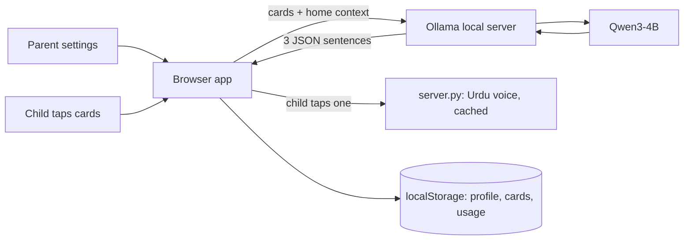
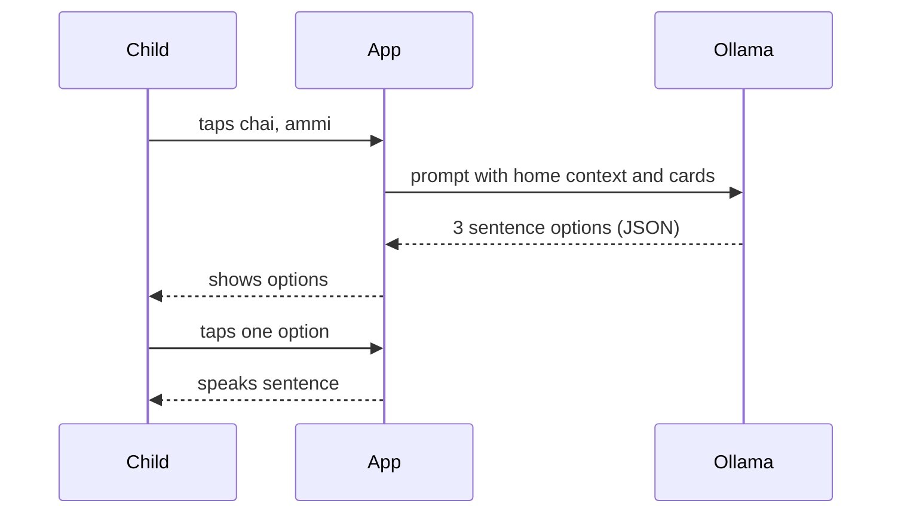

# Awaaz: Urdu AAC for non-speaking children

Awaaz is a picture-card communication app (AAC) built for Pakistani families. A child taps 2 to 4 cards such as "chai" and "ammi". A local AI model uses details the parents entered about the home to turn those cards into natural Urdu sentences, and the app speaks the one the child picks.

Most AAC apps are in English and use Western pictures. Awaaz uses Urdu words, Pakistani food and family terms, and personalises sentences to each household.

> Communication helper only. Not a medical tool and not a replacement for speech therapy.

## Target user and problem

Children with autism, cerebral palsy or other speech difficulties, and the parents who support them. Existing apps are not built around Urdu grammar, local foods or how a Pakistani family talks.

## Core features

- Picture cards with Urdu script and Roman Urdu labels
- Parents describe the home in Roman Urdu (names, relations, favourite food)
- The AI proposes 3 sentence options: direct, polite, and friendly. The child chooses, so the model never speaks for the child without a tap
- Parents can add new cards. The AI writes the Urdu spelling
- Cards the child uses most move to the top
- AI runs fully on the family's computer once the model is downloaded
- Every sentence is checked by code (3 distinct Urdu options, every pressed card present, short length) and regenerated up to 3 times if it fails
- Cards speak when tapped; the chosen sentence is spoken with an Urdu voice (cached after first use)
- Parents can save good sentences, which appear instantly next time and are labelled "Saved"

## AI component

| Item | Value |
|---|---|
| Model | Qwen3-4B (fill in the exact tag you tested, for example `qwen3:4b`) |
| Size | about 4 billion parameters |
| Runtime | Ollama, running locally |
| License of model | Apache 2.0 (check the model card before submitting) |
| Role | Builds personalised Urdu sentences from cards and home context, fixes gender and politeness, and writes Urdu spelling for new cards |

The AI is central: without it the app only shows words. Sentence generation uses Ollama structured output (JSON schema) so the app can show exactly 3 options.

## Setup

1. Install Ollama from https://ollama.com
2. Download the model: `ollama pull qwen3:4b`
3. Install the voice helpers: `pip install -r requirements.txt`
4. In this folder run: `python server.py` (serves the app, forwards requests to Ollama, makes Urdu voice)
5. Open http://localhost:8000 in Chrome or Edge
6. Click "Walidain ki settings" and enter the child's name and a few lines about the home

The status chip in the header shows whether Ollama, the model and the voice engine are ready. In parent settings, "Awaazein tayyar karo" pre-generates and caches the voice of every card. Use "Demo family" for a fictional profile.

No API keys are used and none are needed.

## Architecture

## Sequence

## Testing and findings

Click **Test** in the app for each model (qwen3:4b, gemma3:4b, qwen3:1.7b; all 8B or smaller) and paste each table below. The last column must be filled by a native Urdu speaker.

Fill this in with real results from your own runs. Do not leave invented numbers.

| Cards | Home context | Expected | Actual | Pass or fail | Notes |
|---|---|---|---|---|---|
| chai + ammi | child is a girl | feminine verb, polite to Ammi | | | |
| paani + chahiye | none | simple request | | | |
| dard + sar (new card) | none | sensible sentence | | | |

Model comparison (same 10 inputs): qwen3:4b, gemma3:4b, qwen3:1.7b. Record speed on an 8GB laptop and grammar quality.

## Known limitations

- Not tested with real children or a speech therapist. This is a prototype
- Small models can make Urdu grammar mistakes, so parents should review sentences
- Voice uses online engines (edge-tts, gTTS) through server.py unless the audio is already cached; if both fail the browser's Urdu voice is used, and if none exists the app shows text only
- The automatic check confirms cards are present, not that the Urdu grammar is correct
- Emoji are used instead of a full symbol set to avoid license issues

## Related work

AAC apps already exist, including BOL (LUMS, Urdu and English), All in One AAC (31 languages including Urdu) and Vocalello AAC. Awaaz differs by being free and open source, running the language model locally, building natural family-aware Urdu sentences from cards, letting the child choose among options, and verifying the model's output with code.

## Team

Add names and who did what.

## License and acknowledgements

MIT License, see `LICENSE`. Uses Ollama and Qwen3 (Alibaba Cloud, Apache 2.0). edge-tts and gTTS (Urdu voice), Gemma (if compared; Gemma Terms of Use apply). Add anything else you use.
